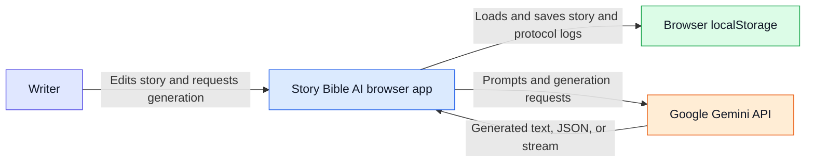

# 01 — System context

This view shows the writer-facing application and its two runtime integrations. Arrows point from the initiating user or system; the browser application exchanges story data with local storage and sends generation requests to Gemini.

**Evidence:** The UI is mounted by `index.tsx` and `App.tsx`; story and protocol data use browser `localStorage`; `services/geminiService.ts` uses `@google/genai` to call Gemini. No server-side intermediary appears in the source.
