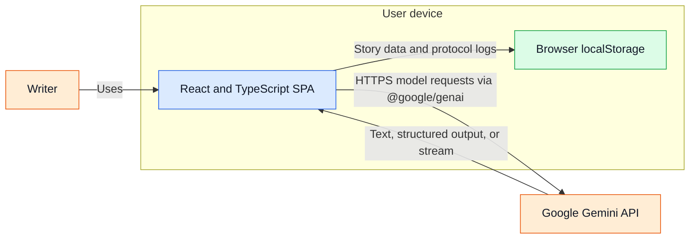

# 02 — Container view

This view separates the executable browser experience from browser-provided storage and the external model API. The Vite development server/build tool is a development/build-time tool, not a separately evidenced production service.

**Evidence:** `index.html` loads the frontend entry point; `package.json` defines Vite scripts; `vite.config.ts` configures the Vite server and build-time environment mapping. Gemini SDK calls and browser storage access are in frontend TypeScript modules. The repository contains no backend service or production deployment manifest.
