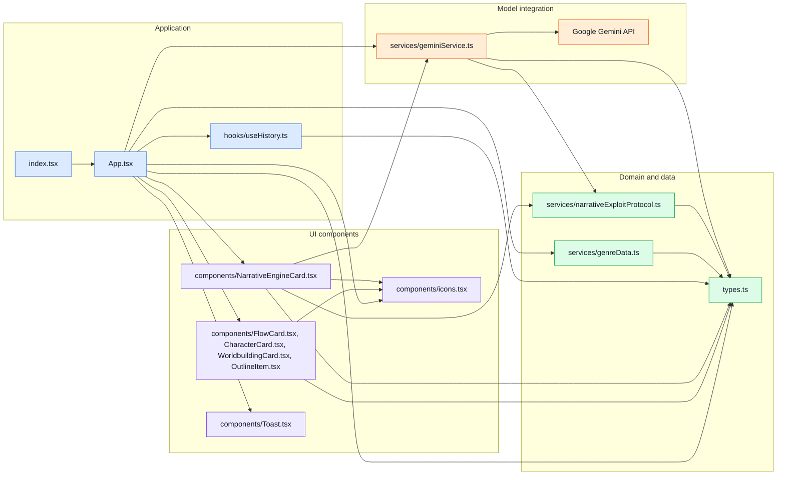

# 03 — Module dependencies

This file-level import map groups the main source modules by responsibility. An arrow means the source module imports or directly depends on the target; grouped component nodes list the concrete files represented.

**Notes:** `services/geminiService.ts` imports the protocol's provider types and implements `exploitLLMProvider`; `NarrativeEngineCard.tsx` constructs the protocol engine with that provider. No cycle appears in these imports. `components/StoryBibleSection.tsx` is empty and is not included as an active module.
