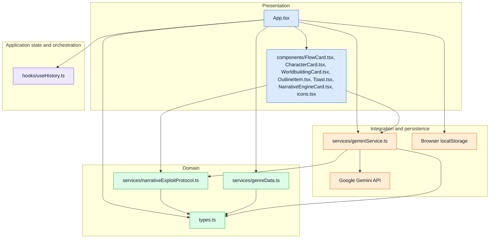

# 04 — Layered architecture

This view groups modules by their primary responsibility, not by runtime process. Arrows show the principal calls and imports across the UI, application, domain, and integration layers; the app currently combines UI composition and orchestration in `App.tsx`.

**Layer notes:** The UI components render and collect user input. `App.tsx` owns the story workflow and calls both domain and integration modules. The history hook manages undo/redo state; genre data and the protocol hold narrative-specific logic. The Gemini service translates generation tasks into SDK requests, while `localStorage` is accessed directly by the app and narrative engine card rather than through a dedicated persistence module.
