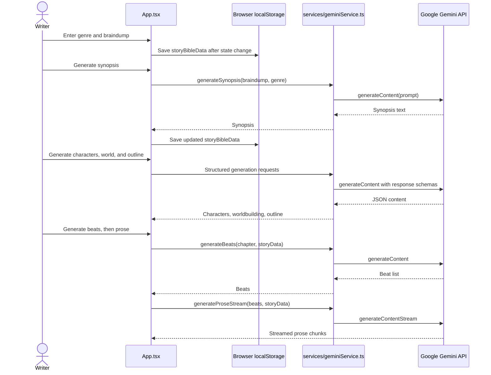

# 05 — Primary flow

This sequence follows a writer from initial story input through outline and chapter prose. Solid arrows are calls or writes; dashed arrows represent returned data. Story changes are saved asynchronously to browser storage; model generation uses Gemini directly from the frontend.

**Evidence:** These handlers are implemented in `App.tsx`; model requests and JSON/stream behavior are implemented in `services/geminiService.ts`. The app's save effect writes `storyBibleData` to `localStorage` after story state changes.
