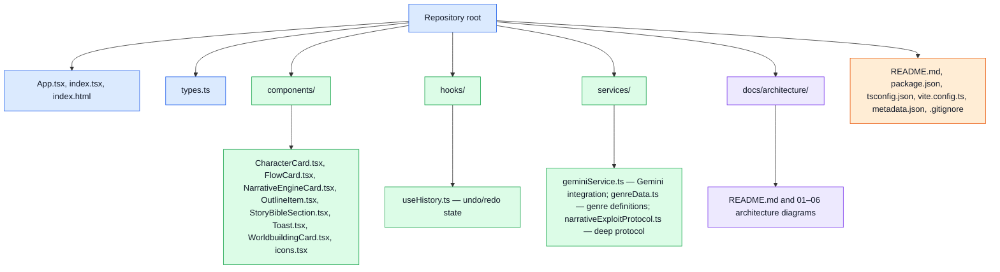

# 06 — Directory map

This map gives the repository's working layout and the purpose of each source folder. File groups in a node are literal paths in that directory; build output and dependency directories are omitted.

**Folder purposes:** `components/` contains React UI components; `hooks/` contains reusable React state logic; `services/` contains Gemini integration and narrative-domain services; `docs/architecture/` contains these architecture notes. Root configuration files define the package scripts, TypeScript settings, Vite setup, and app metadata. `components/StoryBibleSection.tsx` exists but is empty.
